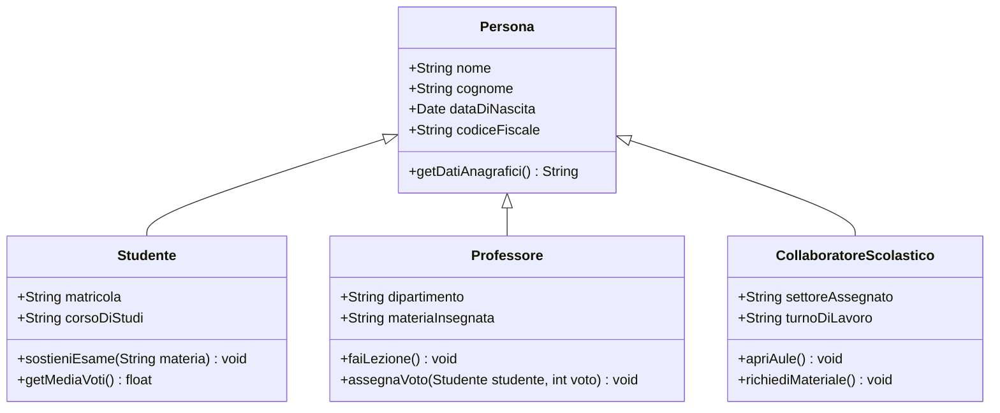

+++

title = "O.O.P. in C#"
description = ".NET, C# e la Object Oriented Programming"
outputs = ["Reveal"]
aliases = [
    "/guide/"
]

+++

##### Istituto Tecnico Tecnologico "Blaise Pascal" **@** Cesena

{}
# **O**bject **O**riented **P**rogramming <br> in C#
{}

**.NET** e la programmazione orientata agli **oggetti**. 

<small>

A cura di Nicholas Magi — `nicholas.magi[at]ispascalcomandini.it`

</small>

<br>

{}

---

{}

#### Parte **#01**
## Il linguaggio **C#** e **.NET**

---

{}
{}


<small> 

  **Anders Heijlsberg**, Ingegnere software danese 

</small>

{}
{}

### Il linguaggio **C#**

- Sviluppato da Anders Heijlsberg intorno al 2000 alla Microsoft.
  - progettista anche del linguaggio **TypeScript**.
- Parte dell'iniziativa *.NET Framework*, poi diventata *.NET Core*, ora **.NET**.
- Sviluppato con la filosofia iniziale di Java, "*write once, run anywhere*"
  - poi i due linguaggi hanno preso pieghe diverse
- Ultima versione: **C# 15** (al *7 ottobre 2026*)
{}
{}

---

### **Java** e la **JVM** (**J**ava **V**irtual **M**achine)

{}

{}

{}

{}

> Write once, run anywhere.

<br>

Architettura della JVM 

Codice Java (*viene compilato in*)$\rightarrow$ Bytecode (*viene eseguito da*)$\rightarrow$ JVM
{}

{}

---

### **.NET** e il **CLR** (**C**ommon **L**anguage **R**untime) 

Stessa filosofia, per più linguaggi.


Architettura del CLR 

Codice C# (*viene compilato in*)$\rightarrow$ CIL (*viene eseguito da*)$\rightarrow$ CLR

--- 

### Il versionamento di **.NET**

{}
{}
#### **Prima** di .NET **5** 
- **.NET Framework**
  - specifico per Windows, sviluppo di applicazioni desktop (WinForm e WPF) e web.
- **.NET Core**
  - multi-platform (Win, Mac, Linux), *meno funzionalità di .NET Framework*, sviluppo web e desktop app
- **Xamarin**
  - mobile-oriented (Andrioid, iOS, Mac OS) 
{}

{}
#### **Dopo** .NET **5** 

{}
Le implementazioni sono allineate e unificate a **.NET**.
{}
{}
{}

---

### Caratteristiche di C#

{}
{}
{}
#### La ricetta

- **C-like** per la parte di programmazione strutturata e imperativa
- **Java-like** per la parte orientata agli oggetti
- **Object-orientation** - garbage collector, oggetti per riferimento...
- **Functional-orientation** - generics, funzioni lambda, delegati...
{}
{}

{}
{}
#### La filosofia
- **Espressività** e **ricchezza di sintassi** - col tempo è diventato un linguaggio con una **grande grammatica**.
{}

$\downarrow$

{}
Attenzione alla **syntactic sugar**!
{}

{}

{}

---

### Tipi di dato semplici: **value types** e **reference types**


<small>
(la mappa non è esaustiva!)
</small>

---

### Tipi di dato **built-in**


<small>Da https://learn.microsoft.com/en-us/dotnet/csharp/language-reference/builtin-types/built-in-types</small>

---

### Sviluppo con .NET - <br> **soluzione vs. progetto**

{}
{}
{}
#### SOLUZIONE
- **Raccoglitore** di progetti
- Gestisce le dipendenze dei vari progetti e le loro varie configurazioni 
- Estensione `.sln` (o `.slnx`)
{}

{}

{}

{}
#### PROGETTO
- **Componente** di un'applicazione
- Memorizza informazioni come
  - versione di .NET utilizzata
  - elenco delle dipendenze e dei pacchetti utilizzati
  - impostazioni di compilazione
  - tipo di output della compilazione (*eseguibile, libreria, ecc...*)
- Estensione `.csproj`
{}

{}
{}

---

```xml
<Project Sdk="Microsoft.NET.Sdk">  
    <PropertyGroup>    
        <TargetFramework>net7.0</TargetFramework>
        <OutputType>Library</OutputType>    
        <Nullable>enable</Nullable>    
        <ImplicitUsings>enable</ImplicitUsings>  
    </PropertyGroup>  

    <ItemGroup>    
        <PackageReference Include="Newtonsoft.Json" Version="13.0.3" />  
    </ItemGroup>  

    <ItemGroup>    
        <ProjectReference Include="..\MyProject.Core\MyProject.Core.csproj" /> 
    </ItemGroup>
</Project>
```

Esempio del contenuto di un **file progetto** (`.csproj`)

---

### Organizzazione dei file di un'applicazione

{}
{}


<small>Esempio su GitHub: https://github.com/dotnet/samples/tree/main/framework/libraries/migrate-library-csproj</small>
{}

{}
- Un **file soluzione** nella root del progetto.
- Tanti file progetto discendenti della soluzione, uno per ogni modulo della mia applicazione.
- Sotto una directory `src/` inseriamo il codice sorgente della nostra applicazione (possono essere previsti più progetti sotto `src/`)
- La directory `tests/` specchia la stessa gerarchia dei file e delle cartelle di `src/`
{}

{}

---

### (*alcune*) Regole di CLEAN Code

{}
{}


{}
{}
- Il codice si scrive in **inglese**!
- *Specify the intent*
  - i nomi delle variabili, classi, oggetti, funzioni o qualunque altra cosa di vostra creazione devono essere SIGNIFICATIVI! No `pippo`, `pluto`, `f(x)`...
- In C# si usa il **PascalCase**! 
  - `PascalCase` per nomi di classi, metodi, proprietà, interfacce, namespace
  - `camelCase` per le variabili
  - `UPPER_CASE_SNAKE_CASE` per le costanti
- Un tab (equivalente a 2 spazi o 4 spazi a seconda della configurazione dell'IDE) per le indentazioni
  - no codice inline o codice mal indentato!
- altre regole sono possono essere prese in prestito da qui: https://web.stanford.edu/class/archive/cs/cs106b/cs106b.1272/course/style_guide/
  - altre ne incontreremo strada facendo
{}
{}


{}

---

{}

#### Parte **#02**
## **O**.**O**.**P**. - le basi

---

### Evoluzione della programmazione nel tempo

{}
{}
{}
#### **Fase 01** <br> Machine Lang 
(prima degli anni '50)
{}

{}
{}
{}
#### **Fase 02** <br> Assembly
(anni '50 - '60)
{}

{}
{}
{}
#### **Fase 03** <br> Linguaggio C
(anni '70 - '80)
{}

{}
{}
{}
#### **Fase 04** <br> OOP (Java, ...)
(anni '90 - '2000)
{}
{}
{}

<br>

- **Machine Lang / Assembly / C** portano ad una visione molto hardware-oriented di un problema
  - gestione di memoria manuale, difficoltà di gestione degli aspetti specifici di un hardware, difficoltà a comprendere/gestire codice scritto da altri...

- Nel tempo nasce la necessità di modellare le **entità** che costituiscono un dominio applicativo, e delle varie **relazioni** tra di loro - minimizzando le risorse (*tempo, fatica...*) dedicate alla gestione di aspetti non inerenti alla risoluzione del problema.
<br>
<br>
    
> Necessità di ASTRAZIONE! 

---

## **Everything** is an **object**.

---

#01. **Everything is an object**. Un oggetto è una **entità** che fornisce operazioni per essere manipolata.

<br>

#02. Un **programma** è un *set di oggetti* che si comunicano cosa fare scambiandosi **messaggi**. Questi messaggi sono richieste per eseguire
le **operazioni fornite**.

<br>

#03. Un oggetto ha una **memoria** fatta di altri oggetti. Un oggetto è ottenuto **impacchettando altri oggetti**.

<br>

#04. Ogni oggetto è **istanza** di una **classe**. Una **classe** descrive il comportamento dei suoi oggetti.

<br>

#05. Tutti gli oggetti di una classe possono ricevere gli **stessi messaggi**. La classe indica tra le altre cose **quali operazioni** sono fornite, quindi per comunicare con un oggetto basta sapere qual è la sua classe.

---

### La classe **Lampadina**

{}
{}

Rappresentazione **UML**
<small>
  **U**nified **M**odelling **L**anguage
</small>

{}

{}

Codice, pt. 1/2
```csharp
namespace BlaisePascal.OOPExamples.Domain;

enum State { ON, OFF }

public class Bulb
{
    // "Memoria" dell'oggetto
    int _brightness;
    State _state;

    // Costruttore
    public Bulb()
    {
        this._brightness = 0;
        this._state = State.OFF;
    }

    // Metodi
    public void On()
    {
        this._brightness = 100;
        this._state = State.ON;
    }

    public void Off()
    {
        this._brightness = 0;
        this._state = State.OFF;
    }
    
    // [...]
```
{}

{}

Codice, pt. 2/2
```csharp 
    // [...]

    public void Dim()
    {
        if (this._brightness - 1 < 0)
        {
            this.Off();
            return;
        }
        this._brightness--;
    }

    public void Brighten()
    {
        if (this._brightness + 1 > 100)
        {
            this.On();
            return;
        }
        this._brightness++;
    }
}
```
{}


{}

---

{}
{}

#### POV: Progettista
```csharp {linenos=inline}
namespace BlaisePascal.OOPExamples.Domain;

public class ComplexNumber
{
    public int Real { get; set; }
    public int Imaginary { get; set; }
    
    public ComplexNumber(int re, int im)
    {
        this.Real = re;
        this.Imaginary = im;
    }

    public ComplexNumber Add(ComplexNumber other)
    {
        return new ComplexNumber(
            this.Real + other.Real, 
            this.Imaginary + other.Imaginary
        );
    }

    public ComplexNumber Subtract(ComplexNumber other)
    {
        return this.Add(new ComplexNumber(
            -other.Real, 
            -other.Imaginary
        ));
    }

    public ComplexNumber Multiply(ComplexNumber other)
    {
        // Formula: (a + ib)*(c * id) = (ac - bd) + (ad + bc)*i
        int a = this.Real; int b = this.Imaginary;
        int c = other.Real; int d = other.Imaginary;
        return new ComplexNumber(a*c - b*d, a*d + b*c);
    } // [...]
}
```
{}
{}
#### POV: Utilizzatore
(Cosa vede chi utilizza la libreria)
```csharp { linenos=inline hl_lines=["8-12", "18-27"] }
namespace BlaisePascal.OOPExamples.Domain.UnitTests;

public class ComplexNumberTest
{
    [Fact]
    public void Constructor_SetsRealAndImaginary()
    {
        // Arrange
        var complex = new ComplexNumber(2, 3);
        // Act & Assert
        Assert.Equal(2, complex.Real);
        Assert.Equal(3, complex.Imaginary);
    }

    [Fact]
    public void Add_ReturnsSumOfRealAndImaginary()
    {
        // Arrange
        var c1 = new ComplexNumber(1, 2);
        var c2 = new ComplexNumber(3, 4);

        // Act
        var result = c1.Add(c2);

        // Assert
        Assert.Equal(4, result.Real);
        Assert.Equal(6, result.Imaginary);
    }

    [Fact]
    // [...]
}
```
{}
{}

---

{}
{}

#### POV: Progettista
```csharp {linenos=inline}
namespace BlaisePascal.OOPExamples.Domain;

enum State { ON, OFF }

public class Bulb
{
    // "Memoria" dell'oggetto
    int _brightness;
    State _state;

    // Costruttore
    public Bulb()
    {
        this._brightness = 0;
        this._state = State.OFF;
    }

    // Metodi
    public void On()
    {
        this._brightness = 100;
        this._state = State.ON;
    }

    public void Off()
    {
        this._brightness = 0;
        this._state = State.OFF;
    }
    
    // [...]
}
```
{}
{}
#### POV: Utilizzatore
(Cosa vede chi utilizza la libreria)
```csharp { linenos=inline hl_lines=["12-17"] }
namespace BlaisePascal.OOPExamples.Presentation;

using BlaisePascal.OOPExamples.Domain;

public class UseBulb
{
    public static void Main(string[] args) 
    {
        Bulb newBulb = new Bulb();
        Console.WriteLine("New bulb created!");
        
        Console.WriteLine(
            "Initial brightness: " + newBulb._brightness
        ); // ERRORE!
        Console.WriteLine(
            "Initial state: " + newBulb._state
        ); // ERRORE!

        for (int i = 0; i < 3; i++) 
        {
            newBulb.Brighten();
        }
        // Here, 'brightness' should be equal to 3 - 
        // we could use xunit to make a unit test 
        // and assert that ;)

        newBulb.On();
        // [...]
    }
}
```
{}
{}

---

### **Classe** vs. **Oggetto**

{}
{}

{}

{}

{}

{}

---

### **4 pillars** of Object Oriented Programming

{}
{}
#### 01. Astrazione
Paradigma orientato al problem solving, prendendo le distanze da dettagli irrilevanti della macchina utilizzata.
{}
{}
#### 02. Incapsulamento
Posso (*io, **progettista***) nascondere in una classe informazioni che non voglio rendere visibili all'esterno (*altri, **utilizzatori***).
{}
{}
#### 03. Ereditarietà
Proprietà e metodi possono essere ereditati di classe in classe, sovrascritti oppure estesi.
{}
{}
#### 04. Polimorfismo
Lo stesso metodo o la stessa proprietà può assumere comportamenti diversi a seconda dello scenario.
{}
{}

{}

---

{}

#### Parte **#03**
## **O**.**O**.**P**. - encapsulation

---

### CLEAN Code / pt. 1

{}
{}
#### Layout
- indentazione di 2-4 caratteri
- linee non più lunghe di 90 caratteri (spezzare in maniera coerente)
{}

{}
#### Commenti
- "`// ...`" commento su una linea
- "`/* ... */`" commento su più linee - utilizzato per commentare sezioni interne del codice
- "`/// <summary> ... </summary>`" commenti di documentazione, da posizionare sopra classi e membri **pubblici** del codice
  - servono per generare documentazione!
{}

{}

#### Istruzioni
- una istruzione per riga
- inizializzare sempre le variabili!
- una definizione di variabile per riga - non fare `int x, y, z;` !

---

### CLEAN Code / pt. 2

{}
{}
#### Ordine delle proprietà di una classe

1. **campi statici** (pubblici, poi privati)
2. **campi d'istanza** (pubblici, poi privati) - proprietà
3. **costruttori** (pubblici, poi privati)
4. **metodi** (raggruppati per ruolo)
{}
{}
#### Nomi
- **Classi, Namespace, Metodi**: PascalCase
  - "`Tree`", "`Graph`", "`Car`", "`Person`"...
- **Interfacce**: PascalCase + "I" maiuscola iniziale
  - "`IEquatable<>`", "`IComparer`", "`ICollection`"...
- **Costanti**: tutte maiuscole, parole separate da "_" 

{}
{}

---

### Esempio: `Point3D` / 1

```csharp
namespace BlaisePascal.OOPExamples.Domain;

/// <summary>
/// Point3D is an example showcasing some functionality of OO in C#, focussing
/// on formatting. All properties have default - private - access.
/// </summary>
public class Point3D
{
    static readonly Point3D ZERO = new Point3D(0, 0, 0);
    
    /*
        A Point3D is made of three fields and has some manipulation functions.
    */
    double _x;
    double _y;
    double _z;

    /// <summary>
    /// Constructor of Point3D class.
    /// </summary>
    public Point3D(double x, double y, double z)
    {
        this._x = x;
        this._y = y;
        this._z = z;
    }

    // [...]
```

---

### Esempio: `Point3D` / 2

```csharp
    /// <summary>
    /// Calculates the squared module of the point, i.e. (x**2) + (y**2) + (z**2).
    /// </summary>
    public double GetSquareModule()
    {
        return this._x * this._x + this._y * this._y + this._z * this._z;
    }

    /// <summary>
    /// Apply translation to point in three axes.
    /// </summary>
    public void Translate(double x, double y, double z)
    {
        this._x += x;
        this._y += y;
        this._z += z;
    }

    /// <summary>
    /// Static method to calculate the point with maximum squared module.
    /// </summary>
    public static Point3D Max(Point3D[] points)
    {
        var max = ZERO;
        foreach (var point in points)
        {
            if (point.GetSquareModule() > ZERO.GetSquareModule())
            {
                max = point;
            }
        }

        return max;
    }
} 
```

---

### Princìpio di decomposizione: **Divide et impera**

> "*Dividi e conquista*", approccio **top-down**.

<br>

> la **soluzione** di un **problema complesso** avviene **dividendolo** in problemi più **semplici**, tra loro **indipendenti**.

#### Esempi

- "Devo sviluppare una *calcolatrice con GUI*"
  - **GUI** + **gestione eventi** + **calcoli matematici**
- "Devo sviluppare un *ecommerce di elettrodomestici*"
  - **Carrello** + **Ordini** + **Pagamenti** + **DB Articoli** + ...

---

### **Decomposizione e modularità**

- i sottoproblemi devono essere **isolati**, **indipendenti**!

#### 3 livelli di decomposizione

1. suddivisione in **namespace** (*simili* ai package di altri linguaggi, tipo Java o Kotlin)

2. suddivisione in **classi** (all'interno di un namespace)

3. suddivisione in **metodi** (all'interno di una classe)

---

### Semplice esempio di incapsulamento: classe `Counter`

{}
{}

#### POV: Progettista

```csharp
public class Counter
{
    // Utilizzo property: sintetizza in una riga
    // - dichiarazione di un field
    // - dichiarazione di un get pubblico default
    // - dichiarazione di un set privato 
    public int Count { get; private set; }

    public Counter()
    {
        this.Count = 0;
    }

    public void Increment()
    {
        this.Count += 1;
    }
}
```
{}
{}

#### POV: Utilizzatore (Console)

```csharp
namespace BlaisePascal.OOPExamples.Presentation;

using BlaisePascal.OOPExamples.Domain;

public class Program
{
    public static void UseCounter(Counter counter)
    {
        int incrementTimes = 4;
        Console.WriteLine(counter.Count); // Should be "0"
        for (int i = 0; i < incrementTimes; i++)
        {
            counter.Increment(); // +1 x 4
        }
        Console.WriteLine(counter.Count); // Should be "4"
    }
    
    public static void Main(string[] args)
    {
        var myCounter = new Counter();
        UseCounter(myCounter);
    }
}
```
{}
{}

---

#### POV: Utilizzatore (**xUnit**) / 1

```csharp
public class CounterTest
{
    private static void CountInArray(int[] array, int target, Counter counter)
    {
        foreach (var item in array) 
        {
            if (item == target)
            {    
                counter.Increment();
            }
        }
    }
    
    [Fact]
    public void Increment_ShouldIncrementCountValueWhenCalledOnArrayCount()
    {
        // Arrange
        var counter = new Counter();
        var sampleArray = new int[] { 10, 15, 10, 30, 75, 40 }; 
        var target = 10; 
        var want = 2;

        // Act
        CountInArray(sampleArray, target, counter);
        var have = counter.Count;

        // Assert
        Assert.Equal(want, have);
    }

```

---

#### POV: Utilizzatore (**xUnit**) / 2

```csharp
    [Fact]
    public void Increment_ShouldIncrementCountValueWhenCalledOnMatrixCount()
    {
        // Arrange
        var counter = new Counter();
        var sampleMatrix = new int[][] {
            new int[] { 10, 80, 90 },
            new int[] { 10, 10, 65 },
            new int[] { 10, 20, 10 },
        }; 
        var target = 10;
        var want = 5;

        // Act
        foreach (var array in sampleMatrix)
        {
            CountInArray(array, target, counter);
        }
        var have = counter.Count;

        // Assert
        Assert.Equal(want, have);
    }
}
```

---

### Qualche osservazione

- La struttura di `Counter` mi impedisce di modificare accidentalmente il valore di `Count`!
  - posso solo **creare** un counter (che parte da 0) e farlo **avanzare** con uno step di 1.
  - l'informazione di `Count` è incapsulata dentro alla classe, che è l'unica che ha possibilità di modifica (utilizzando il modificatore di accessibilità `private`)
- Il codice risultante è più astratto (più di "alto livello"): è più intuitivo leggere "`Count += 1`" oppure "`counter.increment()`"?
  - qualora dovessi cambiare lo step di incremento, dovrei farlo solo all'interno del metodo `increment` e non altrove.
- La scelta di implementare tale classe Counter mi rende il codice riutilizzabile in diversi contesti (come nei test `...OnArrayCount()` e `...OnMatrixCount()`)

---

### Progettazione e implementazione: le fasi

1. Progettazione della **parte pubblica** della classe
2. Costruzione dello stato
3. Completamento implementazione
4. Miglioramento codice finale
5. Test del risultato

---

### Proviamo

{}
{}
### E#00 
`Calculator`
{}
{}
### E#01 
`Circle`, `Square`, `Triangle`
{}
{}
### E#02  
`Student`, `Professor`, `Class`
{}
{}

{}

---

{}

#### Parte **#04**
## Ereditarietà

---

Di cosa stiamo parlando?

<br>
    
{}

**Inheritance**, together with *encapsulation* and *polymorphism*, is one of the three primary characteristics of object-oriented programming. Inheritance enables you to create new classes that **reuse**, **extend**, and **modify** the *behavior* defined in other classes.

{}

---

#### Concettualmente, una classe **figlia** è una *specializzazione* di una classe **padre**.



---

### La classe `Studente` eredita da `Persona`: cosa comporta?

<small>

Da "Microsoft Learn": https://learn.microsoft.com/en-us/dotnet/csharp/fundamentals/object-oriented/inheritance

</small>


{}
{}
{}
### Vengono ereditati
- Proprietà della classe padre
- Metodi della classe padre
- Indicizzatori della classe padre
- ...
{}
{}
{}
{}
### **NON** vengono ereditati
- Costruttori della classe padre
- Distruttori della classe padre
{} 
{}
{}


---

{}

---

{}

#### Parte **#05**
## Interfacce & classi astratte
+ `virtual`/`override`, upcasting, downcasting

---

### PROBLEMA
{}
{}
#### PROBLEM SPACE
Si progetti in C# un software per il calcolo delle retribuzioni mensili di un'azienda per ciascun impiegato. Ciascun impiegato ha un ID, un nome, un cognome e un dipartimento di afferenza (Human Resources, Accountability, Management...)
{}

{}
Sono previsti diversi tipi di impiegati:
1. **A paga oraria** (retribuzione: ore lavorate $\times$ paga oraria, con maggiorazione del $ 150 \\% $ della paga per gli straordinari)
2. **Con salario mensile** (retribuzione: fissa ogni mese, indipendentemente dall'orario di lavoro)
3. **Con salario mensile e commissioni** (retribuzione: fissa ogni mese + vendita (lorda) $\times$ tasso di commissione)
4. **Manager** (retribuzione: salario mensile + (bonus $\times$ percentuale di completamento obiettivi))
5. **Executive** (retribuzione: base di un manager + equità di bonus, calcolata come quote di mercato $\times$ prezzo delle quote)
{}

{}

---

### Una prima - **terrificante** - soluzione / 1

```csharp
namespace BlaisePascal.OOPExamples.Domain.SalaryCalculator.NOInheritance;

public enum EmployeeType { Hourly, Salaried, CommissionSalaried, Manager, Executive }

public class EmployeeRecord
{
    public int Id { get; init; }
    public string FullName { get; init; } = string.Empty;
    public string Department { get; init; } = string.Empty;
    public EmployeeType Type { get; init; }

    // Campi specifici orari
    public decimal HourlyRate { get; init; }
    public double HoursWorked { get; set; }

    // Campi specifici stipendiati / manager
    public decimal MonthlySalary { get; init; }

    // Campi specifici commerciali
    public decimal GrossSales { get; set; }
    public decimal CommissionRate { get; init; }

    // Campi specifici manager
    public decimal TargetBonus { get; init; }
    public double ObjectiveCompletionRate { get; set; }

    // Campi specifici executive
    public int StockSharesGranted { get; init; }
    public decimal ShareMarketPrice { get; init; }

    // [...]
```

---

### Una prima - **terrificante** - soluzione / 2

```csharp
    // [...]
    public decimal CalculatePay()
    {
        switch (Type)
        {
            case EmployeeType.Hourly:
                if (HoursWorked <= 160.0)
                    return (decimal)HoursWorked * HourlyRate;
                decimal baseHoursPay = 160.0m * HourlyRate;
                decimal overtimePay = (decimal)(HoursWorked - 160.0) * (HourlyRate * 1.5m);
                return baseHoursPay + overtimePay;

            case EmployeeType.Salaried:
                return MonthlySalary;

            case EmployeeType.CommissionSalaried:
                return MonthlySalary + (GrossSales * CommissionRate);

            case EmployeeType.Manager:
                return MonthlySalary + (TargetBonus * (decimal)ObjectiveCompletionRate);

            case EmployeeType.Executive:
                decimal managerPart = MonthlySalary + (TargetBonus * (decimal)ObjectiveCompletionRate);
                decimal equityPart = StockSharesGranted * ShareMarketPrice;
                return managerPart + equityPart;

            default:
                throw new InvalidOperationException("Tipo non supportato.");
        }
    }
    // [...]
```

---

### Una prima - **terrificante** - soluzione / 3

```csharp
    // [...]
    public string GetDetails()
    {
        string header = $"[{Id}] {FullName} - Dip. {Department}";
        switch (Type)
        {
            case EmployeeType.Hourly:
                return $"{header} | Orario ({HoursWorked}h a {HourlyRate:C}/h)";
            case EmployeeType.Salaried:
                return $"{header} | Fisso: {MonthlySalary:C}";
            case EmployeeType.CommissionSalaried:
                return $"{header} | Fisso: {MonthlySalary:C} + Provvigione ({CommissionRate:P0} su {GrossSales:C})";
            case EmployeeType.Manager:
                return $"{header} | Fisso: {MonthlySalary:C} + Bonus ({TargetBonus:C} al {ObjectiveCompletionRate:P0})";
            case EmployeeType.Executive:
                return $"{header} | Fisso: {MonthlySalary:C} + Bonus ({TargetBonus:C} al {ObjectiveCompletionRate:P0}) + Equity: {StockSharesGranted} az. ({ShareMarketPrice:C})";
            default:
                return header;
        }
    }
```

---

Due grossi problemi:
- classe **monolitica**
  - vìolato **OCP** - **O**pen-**C**losed **P**rinciple
- logica **ripetuta**
  - vìolato **DRY** - **D**on't **R**epeat **Y**ourself

<br>
<br>
    
> Non stiamo usando i princìpi fondamentali della OOP!

---

### Idea / 1

{}
Osserviamo che, per ciascun dipendente, si presentano delle caratteristiche comuni:
- ID
- FullName
- Department
{}

<br>

{}
Ciascun dipendente, inoltre, ha una funzionalità `CalculateMonthlyPay()` - la cui implementazione cambia a seconda del tipo di dipendente.
{}

---

### Idea / 2

Potremmo quindi pensare di creare una **classe padre** `Employee` che raccolga le caratteristiche a fattor comune, ma che lasci la libertà a ciascuna **specializzazione** di calcolare lo stipendio secondo le sue modalità.

---


### Una soluzione **migliore** / 1

```csharp { linenos=inline hl_lines=["3", "16-17", "19-23"] }
namespace BlaisePascal.OOPExamples.Domain.SalaryCalculator.WithInheritance;

public abstract class Employee
{
    public int Id { get; private set }
    public string FullName { get; private set }
    public string Department { get; private set }

    protected Employee(int id, string fullName, string department)
    {
        Id = id;
        FullName = fullName;
        Department = department;
    }

    // Contratto: ogni sottoclasse concreta deve implementare la formula
    public abstract decimal CalculateMonthlyPay();

    // Metodo estendibile: fornisce l'intestazione comune
    public virtual string GetEmploymentDetails() 
    {
        return $"[{Id}] {FullName} - Dip. {Department}";
    }
}
```

---

### Una soluzione **migliore** / 2

```csharp { linenos=inline hl_lines=["10", "16", "27"] }
namespace BlaisePascal.OOPExamples.Domain.SalaryCalculator.WithInheritance;

public class HourlyEmployee : Employee
{
    private readonly decimal EXTRA = 1.5m;
    public decimal HourlyRate { get; init; }
    public double HoursWorked { get; set; }

    public HourlyEmployee(int id, string fullName, string department, decimal hourlyRate, double hoursWorked)
        : base(id, fullName, department)
    {
        HourlyRate = hourlyRate;
        HoursWorked = hoursWorked;
    }

    public override decimal CalculateMonthlyPay()
    {
        const double standardHours = 160.0;
        if (HoursWorked <= standardHours)
            return (decimal)HoursWorked * HourlyRate;

        decimal standardPay = 160.0m * HourlyRate;
        decimal overtimePay = (decimal)(HoursWorked - standardHours) * (HourlyRate * EXTRA);
        return standardPay + overtimePay;
    }

    public override string GetEmploymentDetails() =>
        $"{base.GetEmploymentDetails()} | Orario ({HoursWorked}h a {HourlyRate:C}/h)";
}
```

---

### Una soluzione **migliore** / 3

```csharp
namespace BlaisePascal.OOPExamples.Domain.SalaryCalculator.WithInheritance;

public class SalariedEmployee : Employee
{
    public decimal MonthlySalary { get; init; }

    public SalariedEmployee(int id, string fullName, string department, decimal monthlySalary)
        : base(id, fullName, department)
    {
        MonthlySalary = monthlySalary;
    }

    public override decimal CalculateMonthlyPay() => MonthlySalary;

    public override string GetEmploymentDetails() =>
        $"{base.GetEmploymentDetails()} | Fisso: {MonthlySalary:C}";
}
```

<br>

// ESERCIZIO: Continuare l'implementazione seguendo il tracciato.

---

### La soluzione usa una **classe astratta**

Con la parola chiave `abstract` si può contrassegnare una classe in cui **non tutto è implementato**
- le classi che ereditano i metodi `abstract` DEVONO fornire una loro implementazione, mediante l'uso di `override`.

<br>
<br>

{}
E cosa vuol dire `virtual`?
- si può usare sia nelle classi astratte che in quelle base, indica un metodo fornito di implementazione che **può** essere sovrascritta dalle classe figlie (utilizzando sempre la parola chiave `override`).
{}

---

### Interfaccia / 1

- Serve un meccanismo per separare esplicitamente, ossia in dichiarazioni
diverse, l’**interfaccia della classe** e la sua **realizzazione**
  - Questo consente di tenere separate fisicamente la parte di “contratto”
(*tipicamente fissa*) con quella di “implementazione” (*modificabile
frequentemente*)
- Consente di separare bene “**abstraction**” e “**concretion**"

---

### Interfaccia / 2

- Contiene solo e soltanto le **firme** dei metodi della mia entità.
  - **Firma = tipo di ritorno + nome + parametri** (p.e. `int CalculateAge(Date birthday);`)
- Con un'interfaccia si crea un nuovo tipo di dato (come per le classi, classi astratte, `int`, `bool`, `string`, ecc...)
  - Posso chiamare solo e soltanto i metodi dichiarati nell'interfaccia
  - Una variabile dichiarata di tipo interfaccia assume solo per valori le **istanze delle classi che implementano l'interfaccia**.

---

### Come realizzare `DomusController` con riutilizzo del codice?


{}

---


{}

#### Parte **#XX**
## Advanced O.O.P.

// TODO

---

- `Object.Equals()`
- Override degli operatori 
- Extension methods 
- Delegati, lambda expressions
- Interfacce base del .NET — `IEquatable<T>`, `IComparer`
- Generics

{}

---

{}

## C# System.**Linq** e <br> 
## la **programmazione funzionale**
**L**anguage-**IN**tegrated **Q**uery

---

## **Programmazione funzionale**
### Una definizione operativa

> **Functional programming** is a way of thinking about software construction by creating **pure functions**. It avoids concepts of **shared state** and **mutable data** observed in **Object Oriented Programming**.

> Functional languages emphasize **expressions** and **declarations** rather than the *execution of statements*. Therefore, unlike other procedures which depend on a local or global state, value output in FP depends only on the arguments passed to the function.

<br>

— da Guru99.com, https://www.guru99.com/functional-programming-tutorial.html

---

#### (alcuni)
### **Concetti chiave**

{}
{}
### Funzioni pure
- dato uno **stesso input**, producono uno **stesso output**
  - $X \to Y$
- no **side effects**!
  - l'unica cosa che una accade in una funzione pura è data dal suo output
```csharp
int sum(x, y) 
{
    return x + y;
}
```
{}
{}
### Immutabilità
- le variabili sono immutabili
  - non possono cambiare nel corso del tempo
  - unico modo: crearne di nuove!

```csharp
// Inizializza una variabile 'x' a 0
int x = 0; 
// Crea una **nuova** variabile 'x' 
// con il valore aggiornato
x = x + 1;
```
(*supponendo di lavorare in un linguaggio basato sul paradigma funzionale*)

{}
{}
### Ricorsione
- no cicli `for` o `while`!
- l'iterazione è realizzata tramite **ricorsione** (funzioni che chiamano sé stesse)

```csharp
int Fibonacci(int n) 
{
    return n >= 1 ? 
        Fibonacci(n-1) + Fibonacci(n-2) : 
        1; 
}
```
{}
{}

---

## **$\lambda$**-calculus

Teoria matematica **preponderante** e **molto rigorosa**.

---

## Alcuni linguaggi di riferimento

{}
{}


<small>
    Un file scritto in Lisp.
</small>

{}
{}
- LISP
- Haskell
- Scala (recente, sviluppi promettenti)
- F# (di casa Microsoft!)
{}

{}

---

### In **C#**: com'è supportata la programmazione funzionale?

---

#### 01. Records <br> (da C# > 9.0)
Concetto identico ad una classe, ma sono **immutabili**.

{}
{}
```csharp
namespace BlaisePascal.OOPExamples.Presentation.Records;

// Dichiarazione delle proprietà direttamente nel costruttore!
public record IntegerPair(int First, int Second);
```
{}
{}


<small>Non posso modificarne i valori! Le proprietà sono `readonly`.</small>
{}
{}

#### Features:
- override di `Object.ToString()` già implementato di default;
  - in questo esempio: `IntegerPair { First = 10, Second = 20 }`
- override di `Object.Equals()` già implementato di default;
  - due istanze di record sono uguali se i valori di ciascuna **proprietà** sono uguali.

---

#### 02. Lambda expressions <br> (da C# > 3.0)
Funzioni anonime assegnabili ad una variabile. Aumentano la **riutilizzabilità** del codice.

> Struttura: 
> `(<parametri>) => <corpo>`

<br>

```csharp
Func<int, int> doubleIt = (int n) => 2 * n;
Func<int, int, int> sum = (int x, int y) => x + y;

Func<int, int, bool> isDivisibleBy = (int n, int d) => n % d == 0; 
Predicate<int> isEven = (int n) => isDivisibleBy(n, 2);
// Equivalent: 
// Func<int, bool> isEven = (int n) => isDivisibleBy(n, 2);

Action<int> printTests = (int i) =>
{
    Console.WriteLine($"Il numero {i}, raddoppiato, vale: {doubleIt(i)}");
    Console.WriteLine($"Il numero {i}, sommato a 100, vale: {sum(i, 100)}");
    Console.WriteLine($"Il numero {i} è pari? {isEven(i)}");
    Console.WriteLine($"Il numero {i} è divisibile per 3? {isEven(i)}");
};

// Usage
var numbers = Enumerable.Range(1, 10);
foreach (int i in numbers)
{
    printTests(i);
}
```

---

#### 03. LINQ 
*Linguaggio di query integrato* che permette di applicare **trasformazioni** a sequenze di dati, rendendo le operazioni di query molto **concise**. 

##### Esempio:
Voglio stampare, in **ordine decrescente**, tutti i numeri da 1 a 100 che sono sia **pari** che **> 20**.

```csharp
var numbers = Enumerable.Range(1, 100); // Elenco di numeri da 1 a 100
```
{}
{}

Opzione 1: Utilizzare la **query expression**
```csharp
IEnumerable<int> resultWithExpression = 
    from number in numbers
    where number > 20
    where number % 2 == 0
    orderby number descending
    select number;
```
{}
{}

Opzione 2: Utilizzare la **sintassi a metodi**
```csharp
IEnumerable<int> resultWithMethods = numbers
    .Where(n => n > 20)
    .Where(n => n % 2 == 0)
    .OrderByDescending(n => n);
```
{}
{}

Confronto tra i due risultati: ottengono la stessa cosa?
```csharp
Console.WriteLine(
    Enumerable.SequenceEqual(resultWithMethods, resultWithExpression)
);
```

(Output atteso: `True`)

{}
